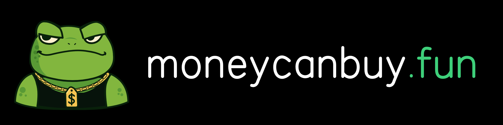

<p align="center">
  
</p>

<h3 align="center">Everyone has a price.<br>Name yours.</h3>

<p align="center">A board of paid dares on Ethereum, judged by the IMD swarm.</p>

---

## What it is

People post dares with a reward attached. Others take them on, do them and submit a public proof link. The contract
holds the money the whole time and pays out by itself: there is no admin over funds.

Judging is decentralised. Anyone but the doer can dispute a submission; identity.md NFT holders vote on disputes; the
[IMD swarm](https://imd.fun) checks large dares before they pay and is the court of appeal for everything else.

## How it works

1. **Post a dare.** Write the condition as a short yes/no rule, pick the proof type (X post, video, on-chain
   transaction or link) and fund the reward in ETH, USDC, IMD or $YOLO. Anyone can add to the reward.
2. **Do it and submit proof.** The doer submits a proof link and puts down a small IMD bond. Dares of $300 or more
   are first checked by the swarm, prepaid by the doer.
3. **Get judged and paid.** A 24 h dispute window follows. No dispute: the doer gets the reward minus a 10% fee. A
   dispute goes to a 24 h vote of identity.md NFT holders; anyone can then take it to the swarm, whose answer is
   final. The losing side's bonds go to the winners and to the NFT voters who were right; the contract settles
   everything.

The full rules, with references to the code: [docs/MECHANICS.md](docs/MECHANICS.md).

## Architecture

- **Contracts v6** ([contracts/](contracts/)), Solidity 0.8.28, Foundry. `TaskVault` is the only address users call
  and approve; it holds every task's money and forwards submissions and disputes to two desks (`CaseDesk`,
  `DisputeDesk`). Parameters live in `ParamsRegistry` behind a 48 h timelock with hard bounds and are copied into
  each task at creation. The state machine is lazy: any call on a task plays its timers, and anyone can settle it.
  The swarm answers through the IMD Intake callback with an EIP-712 attestation.
- **$YOLO**, the project token: 1B fixed supply, no owner, no mint, no pause; an NFT-holders-only first 30 minutes
  (wallet buys; see A-01 in [docs/AUDIT-INTERNAL.md](docs/AUDIT-INTERNAL.md)) and a decaying buy tax in minutes 30 to
  60, then a plain ERC-20. 80% of the pool's 1.25% LP fee (1% of volume) goes to the treasury wallet; anyone may
  call `claimFees`. YOLO bonuses on any dare (`YoloSweetener`) and on-chain trophies of accepted dares
  (`DareTrophy`). Details: [docs/TOKENOMICS.md](docs/TOKENOMICS.md); what the token is used for in the product
  (the doer stake, YOLO Predict, trophies, the NFT buy window): [docs/TOKEN-UTILITY.md](docs/TOKEN-UTILITY.md).
- **Deployment by the swarm.** Everything goes live through the IMD ProjectFactory in four launches (genesis
  contracts, the token with its support contracts, the core, the $YOLO modules), each under the 16,777,216 gas
  cap. The launch texts: [docs/LAUNCH-TASK.md](docs/LAUNCH-TASK.md).
- **No server of our own.** The app that reads and writes the live contracts (not part of this repository) is a
  static site that the swarm publishes to IPFS. It reads the chain through a public RPC, and every action is
  signed and sent by the user's own wallet. Nothing stops or freezes if a helper service disappears: NFT holders
  can submit their own votes, and any visitor can settle a task. [landing/](landing/) is the project's teaser page
  (not the app above): static HTML/CSS/JS, no build step, no backend.

## Status

- **Tests:** 398 Foundry tests (unit, fuzz, invariant, gas, review and audit regression suites, mainnet fork).
  Without an RPC, 393 pass and 5 fork suites (11 tests) skip; with a mainnet archive RPC (`FORK_URL`) those 11 pass
  too, including all four launches through the live IMD ProjectFactory.
- **Audit:** 18 findings; code findings were reproduced by a Foundry test during the audit (0 critical,
  1 high, 4 medium, 7 low, 6 info). The 4 medium are fixed (one in part), the high is a documented limit of the
  factory launch:
  [docs/AUDIT-INTERNAL.md](docs/AUDIT-INTERNAL.md). Acknowledged findings are described there; each lists its impact
  and the accepted risk.
- **Swarm audit:** the IMD swarm audited commit `d9a1ee5` of this repository: 11 findings (3 medium, 5 low,
  3 info, no critical or high), all fixed; the report's PoCs pass as regression tests in
  `contracts/test/audit/swarm117/`. Details: the "Swarm audit of d9a1ee5" section of
  [docs/AUDIT-INTERNAL.md](docs/AUDIT-INTERNAL.md).
- **Second swarm audit:** a second pass at commit `7714a24` (after the 11 findings above were fixed and
  `HiddenList` was added): one medium, four low, no critical or high, all fixed or acknowledged (two low findings
  are documented design decisions, not code changes). PoCs in `contracts/test/audit/round2/` and new regression
  tests in `contracts/test/HiddenList.t.sol`. Details: the "Second swarm audit, of `7714a24`" section of
  [docs/AUDIT-INTERNAL.md](docs/AUDIT-INTERNAL.md).
- **Owner wallets are placeholders.** The five project wallets (treasury, incentives, Stabilizer, dev, team) appear
  as `<TREASURY_WALLET>` and so on in the docs and as `0xF001`…`0xF005` in `contracts/script/LaunchPlan.sol`.
  The real addresses are placeholders until launch. `safe()` in `ProtocolDirectory` is the owner address:
  the treasury wallet, a single EOA, not a Gnosis Safe.

## Repository

```
README.md
brand/           logo, mascot, banners, favicons and the brand book
landing/         the teaser site (static HTML/CSS/JS, no build step)
docs/
  MECHANICS.md       the rules of the board, with code references
  TOKENOMICS.md      $YOLO supply, split, unlocks and the first hour
  TOKEN-UTILITY.md   what $YOLO is used for in the product: rewards, the doer stake, YOLO Predict, trophies, NFT
  AUDIT-INTERNAL.md  the internal audit: method, findings, fixes
  LAUNCH-TASK.md     the four launch texts for the IMD swarm
contracts/       Foundry project
  src/             the contracts
  test/            unit, fuzz, invariant and gas tests; test/audit, test/review: findings turned into tests;
                   test/fork: mainnet fork tests
  script/          LaunchPlan.sol (the order and constructor arguments of the four launches),
                   check-launch-task.py (docs/LAUNCH-TASK.md against the code)
  foundry.toml
  lib/             dependencies as git submodules (not vendored)
```

## Build and test

You need [Foundry](https://getfoundry.sh) and git.

```
git clone --recursive <this repository>
cd <repository>/contracts
forge build --sizes
forge test                                   # 393 pass, 5 fork suites skip without FORK_URL
FORK_URL=<mainnet archive RPC> forge test --match-contract Fork -vv   # the 11 fork tests
python3 script/check-launch-task.py          # launch texts in docs/LAUNCH-TASK.md = arguments in the code
```

Cloned without `--recursive`: run `git submodule update --init --recursive` first. Dependencies are pinned:
forge-std v1.17.0, OpenZeppelin Contracts v5.1.0 and Uniswap v4-core at `46c6834`, from which only four math
libraries are used, by the fork rehearsal of the launch. More in [contracts/README.md](contracts/README.md).
