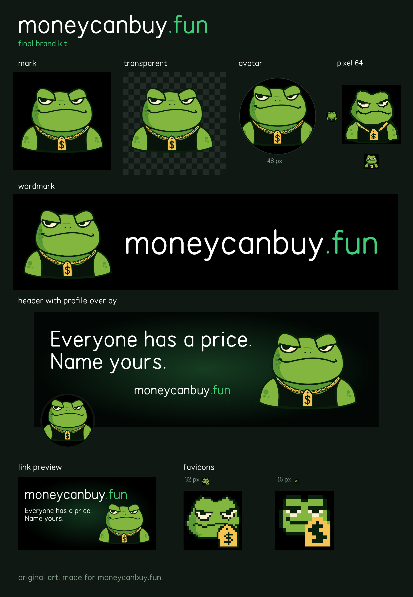

# moneycanbuy.fun brand book

## The mascot

The price dealer: a heavy, smug toad who already knows your price.

- Heavy, half-lowered eyelids and a slow side smirk. He is never surprised.
- Black tank top, gold chain, and a gold `$` price tag hanging on the chain like a pendant.
- Thick dark outline, flat colours, crisp edges, no gradients on the character.
- He is our own character, drawn for this project. He is not stock Pepe and does not borrow from any existing frog artwork or NFT collection.

The price tag is the brand symbol. It is always gold, always on the chain, always separated from the green skin by the dark outline.

## Files

| File | Size | Use |
| --- | --- | --- |
| [mark-1024](mark-1024.png) | 1024×1024 | Mark on black |
| [mark-transparent-1024](mark-transparent-1024.png) | 1024×1024 | Mark, transparent |
| [avatar-400](avatar-400.png) | 400×400 | Profile picture |
| [mark-pixel-64](mark-pixel-64.png) | 64×64 | Pixel UI, 48–64 px |
| [favicon-32](favicon-32.png) | 32×32 | Browser tab |
| [favicon-16](favicon-16.png) | 16×16 | Small tab |
| [wordmark-2400x600](wordmark-2400x600.png) | 2400×600 | Logo with name |
| [x-banner-1500x500](x-banner-1500x500.png) | 1500×500 | X header |
| [og-1200x630](og-1200x630.png) | 1200×630 | Link preview |
| [sheet](sheet.png) | 1800×2600 | Whole kit |

All files are PNG, sizes in pixels. The profile picture is safe for a circle crop and reads at 48 px. The X header keeps its bottom-left 400×200 empty for the profile picture. The link preview reads at 600×315.

## Colour

Measured from the PNG files in this folder (most frequent exact pixel values), not picked by eye.

| Hex | Role |
| --- | --- |
| `#000000` | Background. Pure black behind the mark, avatar, wordmark, favicons |
| `#82B63E` | Toad green, main skin |
| `#599A35` | Toad shade (under the eyes, shoulders) |
| `#44842A` | Toad spots on cheeks and shoulders |
| `#09210B` | Outline, the dark green around everything |
| `#07130B` | Tank top |
| `#FFF0CF` | Eye cream |
| `#F5C451` | Gold: the `$` price tag and the chain |
| `#FFE185` | Gold highlight on the tag and chain |
| `#3ECF7A` | Neon green accent: `.fun` in the wordmark, the one accent colour |
| `#FFFFFF` | Text: the wordmark and the slogan |
| `#1B5934` → `#020604` | Banner glow: brightest point in the centre of the X header, fading to near-black at the edges |

## Type

The lettering in the wordmark, the X header and the link preview is custom: a clean, rounded, monoline geometric sans drawn for this kit, with real lowercase `p` and `y` descenders. It is artwork, not a font file. Use the PNG files, do not retype the logo.

For live text next to the brand (the site, posts, slides) use **Quicksand** (SIL Open Font License 1.1), weights 500 to 700. It is a rounded sans close to the wordmark, though not identical. Numbers and amounts use **IBM Plex Mono** (SIL OFL 1.1).

## Clear space and minimum size

- **Clear space:** keep empty space of at least half the height of the `$` tag around the toad on every side, and the same around the wordmark. The supplied files already include this margin; do not crop it away.
- **Illustrated mark and avatar:** readable down to **48 px**. The avatar was checked at 48 px inside a circle.
- **Below 48 px** use the pixel files, which are drawn pixel by pixel for each size, not scaled down: `mark-pixel-64.png` at 48 to 64 px, `favicon-32.png` at 32 px, `favicon-16.png` at 16 px. Show them at 1×, 2×, 3× and so on with nearest-neighbour scaling, never smoothed.
- **Wordmark:** at least **320 px** wide. Below that, use the mark alone.

## Do

- Put the mark on pure black or a flat, dark background.
- Keep the tag gold and the `.fun` neon green.
- Use the pixel files at small sizes and the illustrated files at large sizes.
- Scale proportionally.

## Don't

- Don't recolour the price tag, the chain or the toad. The tag is always gold.
- Don't put the toad twice next to itself (no mirrored pairs, no rows of toads in one lockup).
- Don't stretch, squash, rotate or skew any file.
- Don't put the mark on busy backgrounds: photos, patterns, gradients behind the character.
- Don't blur or smooth the pixel versions, and don't scale the 1024 px mark down to favicon size.
- Don't redraw the wordmark in another font or change its colours.
