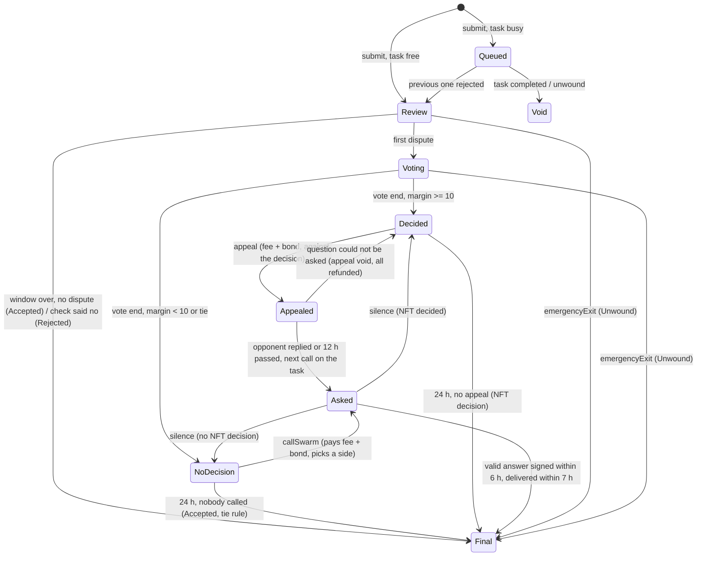

# moneycanbuy.fun mechanics (TaskVault v6)

> Current $YOLO rules: [docs/TOKENOMICS.md](TOKENOMICS.md) and [docs/TOKEN-UTILITY.md](TOKEN-UTILITY.md). Where this page differs from them, they apply.

The rules as the code enforces them, with a code reference for each one. Paths are relative to `contracts/src/`
unless they start with `contracts/` or `script/` (`script/` means `contracts/script/`). Values are the launch values
(registry version 1, `VaultParams.sol:133-171`). Edge-case rules that are easy to miss are collected under "Rules worth
knowing" at the end. The supply, vesting and first-hour rules of the project token $YOLO are in `docs/TOKENOMICS.md`.

## Overview

An author locks a reward in ETH, USDC, IMD or the project token $YOLO for a task written from a template. A doer submits one proof link and an
IMD bond; one submission is judged at a time, the rest wait in a queue. If nobody disputes within 24 h, the doer gets
the reward minus 10%. Anyone but the doer can dispute with an IMD bond and a small ETH fee. Disputes go to a gasless vote of
identity.md NFT holders (EIP-712 signatures, relayed in batches). Their decision can be appealed to the IMD swarm, and
when they do not decide anyone can call the swarm. The swarm's answer is final; a silent swarm reopens the window. The
losing side's bonds pay the winners, the NFT voters who were right, and the treasury. All payouts are pulled. The vault
has no owner. A task keeps the parameters it opened with.

## Participants

| Who | Can do | Code |
|---|---|---|
| Author | `createTask` with reward, deadline, title, condition, category, proof type, cover; pays a non-refundable creation fee; is the first contributor | `TaskVault.sol:207-270` |
| Contributor (incl. author) | `topUp` the reward (same currency); `withdrawContribution` under the rules below | `TaskVault.sol:274-341` |
| Doer | `submit` proof + bond (+ check prepayment for large tasks); `reply` once to disputes; `claimVoidSubmission` if their queued submission never ran | `desks/CaseDesk.sol:52-135` |
| Disputer (anyone but the doer, incl. the author; audit C-01) | `dispute` once per submission while the dispute window is open; `claimDisputer` after the end | `desks/DisputeDesk.sol:48-81`, `:212-239` |
| NFT holder / delegate | signs an EIP-712 vote with any number of their tokenIds; `claimVoterReward` goes to the signed `payTo` | `libraries/VoteLib.sol:17-27`, `desks/DisputeDesk.sol:244-262` |
| Relayer (anyone can run one) | `submitVotes` batches; gets gas back in ETH from the dispute pot, the rest in IMD from the loser | `desks/DisputeDesk.sol:88-120`, `:431-456` |
| Appellant / swarm caller (anyone) | `appeal` an NFT decision, or `callSwarm` when there is none, paying bond + live swarm fee | `desks/DisputeDesk.sol:130-190` |
| Appeal opponent | `appealReply` once: the doer, or any disputer when the appeal sides with the doer | `desks/DisputeDesk.sol:193-205` |
| IMD swarm (Intake) | answers yes/no through `onOracleResult` only (no public fallback, audit B-01) | `TaskVault.sol:445-468` |
| Treasury (the project wallet `<TREASURY_WALLET>`, also funded by its vesting) | receives fees and remainders; the vault never pays a cost out of it; `sweepTreasury` (anyone) credits it, then it withdraws. Dares the project funds are paid from the incentives wallet | `TaskVault.sol:483-490` |
| Parameters | New parameter/attester values take effect after a 48 h timelock, within hard bounds; no function moves money. Task creation can be paused. `HiddenList`: `setState` hides, unhides or pins a task or proof on the site, instant, no timelock, no money moved either | `ParamsRegistry.sol:16-21`, `:76-99`, `:175-211`; `HiddenList.sol:90` |
| NFT holder / delegate (moderation) | `vote` to hide or keep a task or proof on the site (separate from the dispute vote above): 24h round, passes at >= 10 hide NFTs, more hide than keep, >= 3 distinct hide wallets | `HiddenList.sol:115` |
| Anyone | `poke` (play timers), `emergencyExit`, `sweepTreasury`, `withdraw` own credits; `sampleYoloPrice` on the oracle (plain EOAs only) | `TaskVault.sol:347-365`, `:472-490`; `oracles/YoloPoolSamples.sol:82-98` |

## Task lifecycle

- **Create.** Currency ETH, USDC, IMD or $YOLO (`TaskVault.sol:221-223`); deadline 0 = none, otherwise in the future (`:224`);
  title 1..80 bytes, condition 1..256 bytes (text rule below), category < 7, proof type < 4, cover empty / `ipfs://…`
  / `https://…` ≤ 160 bytes (`:232-236`); creation fee ≥ 0.0005 ETH to the treasury pot (`:237`, `:266`); amount
  1..2^128-1 (`:238`); minimum reward $5 by oracle, or 0.5 IMD for IMD tasks; a $YOLO task has the $5 minimum only while the
  oracle has a YOLO price, otherwise none (`:239-248`). ETH comes in `msg.value`, USDC and $YOLO by `transferFrom`, IMD
  by `transferFrom` or a swap (`:625-642`). Title and cover live only in
  the `TaskCreated` event; nothing set here can change later. Blocked while task creation is paused (`:220`).
- **Top up.** Same currency, before the deadline, task Open (`TaskVault.sol:277-279`), no contributor fee (`:293`).
  While a submission is active the top-up is **pending** (`:283-287`): it is not part of the reward in play.
- **Pending top-ups.** When a busy period ends with a rejection and an empty queue, all pending top-ups join the pot and
  `busyEpoch` advances (`TaskVault.sol:427-431`); each contributor's pending share turns active lazily
  (`:616-622`). If the submission is accepted, pending top-ups stay withdrawable.
- **Withdraw.** Pending: any time. Active share: while the task is Open with no active submission, once the
  contributor's public notice is due (`announceWithdraw`: from 1 h after it, for 24 h; swarm audit #8), or
  after Expired / Unwound with no notice (`TaskVault.withdrawContribution`). A doer sees the reward leaving an hour
  before it can go; a submission sent in that hour locks the share until its result. There is no author cancel; the
  author withdraws like any contributor. The pot can
  fall below the minimum reward this way (only `pot > 0` is required to submit, `desks/CaseDesk.sol:66`).
- **Deadline.** Closes `submit` and `topUp` only (`desks/CaseDesk.sol:65`, `TaskVault.sol:278`). An active submission
  and the whole queue are still judged to the end. The task becomes **Expired** only when the deadline passed and no
  submission is active (`TaskVault.sol:604-609`); then everyone withdraws their share.
- **Statuses:** Open → Completed (accepted) / Expired / Unwound (emergency exit) (`VaultTypes.sol:43-49`,
  `TaskVault.sol:411-433`). A rejection keeps the task Open.

## Submission lifecycle

- **Submit** (`desks/CaseDesk.sol:52-108`): one link of the task's proof type (`helpers/TextRules.sol:117-125`):
  `x_post` = `https://[www.|mobile.|m.](x.com|twitter.com)/<handle>/status/<id>`; `video` = YouTube / youtu.be / Kick /
  Twitch link or an X post; `onchain_tx` = `0x` + 64 hex; `link` = any `https://` link. Optional evidence: a screenshot
  (sha2-256 digest of an IPFS block) and a note ≤ 200 bytes (`:71-73`, `:96-103`). `minReward` reverts if the pot
  shrank (`:67`), `maxImdIn` caps bond + check fee (`:90`). Irrevocable. The reward `R` is the pot at this moment
  (`:81`) and stays fixed.
- **Bond** (IMD, all of it penalty): `max(minBond, bondBase + 3% × R_imd) × 2^min(rejected + ahead, 8)`
  (`desks/Desk.sol:116-131`), where `R_imd` = R in IMD by the oracle at submission (IMD tasks: R; `:140-146`;
  $YOLO tasks without a reliable YOLO price: R_imd = the large threshold `largeRewardImd`, `desks/Desk.sol:156-188`),
  `rejected` = rejected submissions of the task, `ahead` = the active one plus the queue (`TaskVault.sol:395-397`).
  So the first queued submission already pays ×2.
- **Queue.** If a submission is active, the new one is Queued (`desks/CaseDesk.sol:94`, `:104-105`;
  `TaskVault.sol:403-407`). On a rejection the next queued one becomes active and its dispute window starts then
  (`TaskVault.sol:422-426`, `desks/CaseDesk.sol:399-400`). On acceptance or unwind every queued submission turns Void
  and its doer takes back bond + check prepayment (`desks/CaseDesk.sol:110-124`).
- **Mandatory swarm check** for large rewards: `R ≥ $300` by oracle, or `R ≥ 40 IMD` for IMD tasks
  (`desks/Desk.sol:146`, `:150`). A $YOLO task is large at $300 of its oracle value (YOLO capped at $0.01, so at least
  30,000 YOLO) and always large while the oracle has no reliable YOLO price (`desks/Desk.sol:184-187`). The doer prepays the live swarm price at submit (`desks/CaseDesk.sol:84-87`; reverts
  `ActionNotSold` if the swarm does not sell). It is asked when the submission becomes active (`:286-308`): "no" →
  Rejected, bond to the treasury (`:149-152`, `desks/DisputeDesk.sol:536`); "yes" → 24 h dispute window from the moment
  the answer was recorded; silence (6 h + the 1 h delivery grace) → 24 h window from the moment of silence, fee lost (`desks/CaseDesk.sol:153-157`). If
  the question cannot be asked at activation (price now above the prepayment, not sold, Intake failing), the
  prepayment is credited back and the window opens at once (`:303-306`).
- **Dispute window** 24 h from activation (`desks/CaseDesk.sol:306`). Nobody disputed → Accepted (`:160-161`).

Phases: `VaultTypes.sol:51-62`; transitions: `desks/CaseDesk.sol:140-204`. Every open step can also go to Final/Unwound
through the emergency exit (only two arrows drawn). Timers are played lazily by the first call that touches the task,
at most 8 transitions per call (`TaskVault.sol:599-613`); `poke(taskId)` does only that.

## Disputes

- Allowed in Review or Voting while `now < windowEnd`, and not during a pending mandatory check (`windowEnd = 0`)
  (`desks/DisputeDesk.sol:52-54`). Any number of disputers, one dispute per address (`:59`).
- Cost: bond `max(minBond, bondBase + 1% × R_imd)` in IMD (`:62`, `desks/Desk.sol:116-120`) + an ETH fee chosen in
  [0.0003, 0.01] ETH (`desks/DisputeDesk.sol:57`) that goes into the dispute pot and pays vote relayers (`:71-72`).
  Reason: text ≤ 256 bytes.
- The first dispute starts a 24 h vote and the doer's 12 h reply window (`desks/CaseDesk.sol:219-226`); more disputers
  can join until the dispute window ends. The doer cannot dispute their own submission (`DoerCannotDispute`, audit C-01),
  nor appeal its acceptance or call the swarm against it (same error, swarm audit #4); they may appeal a
  rejection and call the swarm for themselves.
- The swarm question carries the first 16 reasons (`maxClaims`) plus the caller's own reason and the opponent's reply
  (`helpers/SwarmQuestion.sol:171-176`, `desks/DisputeDesk.sol:296-311`).

## NFT voting

- **Ballot:** EIP-712 `Vote(uint256 subId,uint8 side,uint256[] tokenIds,uint64 voteEnd,address payTo)`, domain
  `("IMD TaskVault", "1", chainId, vault)` (`libraries/VoteLib.sol:46-47`, `desks/DisputeDesk.sol:391-397`). Side 1 =
  accept (doer right), 2 = reject. 1 NFT = 1 vote.
- **Batches:** anyone relays `submitVotes(subId, ballots)` while phase is Voting and `now < voteEnd`
  (`desks/DisputeDesk.sol:93`). Signature: ECDSA by `voter` first, then ERC-1271 (`libraries/VoteLib.sol:169-184`; an ERC-1271 check gets at most 500,000 gas, audit C-03).
  Each tokenId must be owned by the voter now or delegated to them on delegate.xyz (`:186-205`) and counts once per
  submission (bitmap, `:96-105`). A wallet votes one side per submission: a ballot of a voter who already voted the
  other side is skipped (reason 4) and its NFTs stay unused (swarm audit #5). Bad ballots are skipped with
  `BallotSkipped`, never revert the batch (`:77-109`).
- **Decision** (`desks/CaseDesk.sol`, `_tryDecide`): only at `voteEnd`, if `|accept − reject| ≥ 10` and the winning side
  has ≥ 1 distinct signer wallet. There is no instant decision on a partial count (audit C-02; the `instantDelta`
  parameter stays in the set, unread), so the order of batches does not matter.
- **Tie / no decision:** equal counts or a margin under 10 at vote end → NoDecision (`:314-318`, `:164-170`); the NFT vote
  is then ignored in the money split.
- **Relayer reimbursement** (`desks/DisputeDesk.sol:431-456`): measured gas + 30,000 base + 16 gas per calldata byte,
  capped at `30,000 + 60,000 × NFTs counted in the batch`, × `basefee` × 1.10. Paid as an ETH credit from the dispute
  pot; any **shortfall** is recorded in IMD at the IMD/ETH rate fixed at submission and paid from the loser's bonds
  before the split, all relayers of a case together at most 20% of that penalty (`MAX_SHORTFALL_BPS`, swarm audit
  #3: winners and correct votes always share the other 80%), pro rata; never on an emergency exit (`:270`). For IMD tasks
  with no oracle rate the shortfall is not recorded (`desks/Desk.sol:140-144`). A batch that counts nothing is not
  reimbursed (`desks/DisputeDesk.sol:116-118`).

## The swarm

- **When asked:** (1) mandatory check of a large submission, paid by the doer's prepayment; (2) `callSwarm` in
  NoDecision, asked at once, the whole transaction reverts if the Intake fails (`desks/DisputeDesk.sol:184-185`);
  (3) `appeal` in Decided, asked lazily by any call on the task once the opponent replied or 12 h passed
  (`desks/CaseDesk.sol:182-187`). Kinds: `VaultTypes.sol:10-12`.
- **Who pays:** the caller pays the live Intake price in IMD (`desks/Desk.sol:107-114`; 0.5 IMD at the time of writing),
  capped by their `maxImdIn` (`desks/DisputeDesk.sol:142`, `:174`). The gas of a lazily asked
  appeal question is paid by whoever makes that call. A winning caller gets the fee back from the loser's bonds
  (`:509-514`). The treasury pays nothing.
- **Appeal voided:** if at ask time the live price exceeds the prepaid fee, is 0, or the Intake fails, the appellant
  gets bond and fee back, the NFT decision stands and a new 24 h appeal window starts (`desks/CaseDesk.sol:328-347`).
- **Question:** built on chain from stored data only: `<prefix>TASK: <condition> | PROOF: <link> | PROOF TYPE: <type> |
  DOER: <address> | DOER CODE: IMD-<taskId>-<doer address> | CASE: <task>//<nonce>`; party texts go to
  `definitions` marked untrusted (`helpers/SwarmQuestion.sol:55-102`, `VaultParams.sol:166-169`). Body asks a 7-agent
  panel with quorum 5, bool answer (`VaultParams.sol:170-171`).
- **Answer binding:** the callback must come from the Intake the question was sent to, for a known, unanswered
  request id (`TaskVault.sol:448-461`); otherwise ignored, never reverts. The attestation must be a bool 0/1, from a
  panel ≥ 7 with quorum ≥ 5, `quorum ≤ agreed ≤ panelSize`, signed (EIP-712 domain "IdentityMD Oracle" v2, consumer =
  vault) by a registry attester, not past its signed `expiresAt` (swarm audit #9)
  (`helpers/AttestationChecker.sol`). Anything else = no answer. There is no public
  fallback: an answer that does not arrive through the callback is silence (audit B-01).
- **Timeout and silence** (`desks/CaseDesk.sol`, `_swarmStatus`): an answer counts if its signed time (clamped to
  [asked, recorded], `TaskVault._recordAnswer`) is within 6 h of the ask and it reached the vault within 1 h after that
  (`SWARM_DELIVERY_GRACE`). Silence = no such answer by 7 h after the ask (silence from that moment), or no answer
  recorded and the Intake already reports the request completed (silence from then). Nothing turns silent while an
  answer signed in time can still count, so the outcome never depends on who pokes when (swarm audit #7). A
  window after an answer starts when it was recorded on chain.
- **Silence on a call / appeal:** the caller's fee is lost, their bond (and unspent fee) is credited back, the phase goes
  back to NoDecision or Decided and a new 24 h window starts from the moment of silence (`desks/CaseDesk.sol:193-200`,
  `desks/DisputeDesk.sol:320-325`). Repeats are allowed, each at the new caller's cost. Silence on the mandatory check:
  see above.
- **Final:** a valid answer ends the case: yes = Accepted, no = Rejected (`desks/CaseDesk.sol:191-192`).

## Money and fees

All amounts are credited to buckets at settlement and pulled with `claim*` / `withdraw` (`desks/DisputeDesk.sol:207-279`,
`TaskVault.sol:472-479`); a failed direct transfer stays as a credit (`TaskVault.sol:649-657`).

| Rule | Value | Code |
|---|---|---|
| Doer bond | `max(1 IMD, 0.5 IMD + 3% R_imd)`, ×2 per rejection and per submission ahead, at most ×256; bonds are always IMD, also for $YOLO tasks | `desks/Desk.sol:116-131` |
| Dispute / appeal / swarm-call bond | `max(1 IMD, 0.5 IMD + 1% R_imd)` | `desks/DisputeDesk.sol:62`, `:141`, `:173` |
| Creation fee | ≥ 0.0005 ETH, to the treasury, never refunded | `TaskVault.sol:237`, `:266` |
| Fee on an accepted reward | 10% of R in the reward currency (ETH, USDC, IMD or YOLO); doer gets 90% | `desks/DisputeDesk.sol:557-565` |
| ...after a dispute the NFT decided right | 6% of R to the correct NFT votes, 4% to the treasury | same, `:560` |
| ...no dispute, or NFT undecided / wrong | all 10% to the treasury | same |
| Loser's bonds ("penalty") | (0) winning swarm caller's fee back, (1) relayer shortfall, at most 20% of the rest, then split | `desks/DisputeDesk.sol:470-552` |
| ...NFT decided right | 50% to the winners pro rata to bonds, 50% to the correct votes | `:534-537`, `:569-596` |
| ...NFT undecided or wrong, swarm answered | 100% to the winners | `:534-537` |
| ...tie: NoDecision and nobody called (or every call went silent) | disputers' bonds 50% to the doer, 50% to the treasury | `:528-532`, `desks/CaseDesk.sol:176` |
| ...check said no (no winner) | doer bond to the treasury | `desks/DisputeDesk.sol:536` |
| Winner who contributed to the task | gets only their own bond; their share goes to the correct votes (NFT right) or the treasury; re-checked at settlement | `:530`, `:583`, `:588`, `:591-592`, `:539-540`, `:598-602` |
| Disputer who contributed after disputing | their share goes to the treasury | `:226-227` |
| Dispute ETH pot | after relayers, back to all disputers pro rata to their fees, in every outcome | `:230-235`, `:333-335` |
| Voter reward | `payTo` of votes on the final side, pro rata to counted NFTs; only if the NFT decided and the final outcome agrees | `:244-262`, `:344-345` |
| Reward | goes only to the doer or stays in the task, never to a disputer or caller | `:346`, `TaskVault.sol:414-415` |

Rejected: the reward stays in the pot, the task stays Open (`TaskVault.sol:421-431`). Example at IMD = $7.65: a 300 USDC
task is 39.22 IMD, so the doer bond is 0.5 + 1.18 = 1.68 IMD and a dispute bond is 1 IMD (the 0.89 IMD formula result
is below the 1 IMD floor).

**Liabilities invariant.** Every held amount belongs to one bucket (task pot / pending, bonds, prepayments, dispute ETH
pot, settlement bucket, treasury pot, user credit); `liabilities[token]` is their sum, changes only when money enters
or leaves, and `balance ≥ liabilities` (`TaskVault.sol:36-40`, `:85`). Only the vault moves money; the desks tell it
what to book (`TaskVault.sol:511-593`). Payment mode B pulls IMD and checks the received amount (`:703-707`); mode A
swaps ETH or USDC through Uniswap v3 with the user's `minImdOut` and deadline and refunds the surplus (`:709-742`).

**Treasury sweep.** `sweepTreasury(token)` (anyone) credits the whole treasury pot to the treasury address of the
registry's *current* version, which then calls `withdraw` (`TaskVault.sol:483-490`).

**Doer bond.** At `max(1 IMD, 0.5 IMD + 3% R_imd)` (formula above), a $100 task prices to 1 IMD (the floor;
$100 ≈ 13.07 IMD at $7.65/IMD, so 0.5 + 3% of that is below 1 IMD), and a $300 task (the mandatory-check
threshold) prices to about 1.68 IMD. A doer whose proof is disputed and rejected loses the bond and gets none of
the reward, which stays in the task. Half the forfeited bond goes to whoever disputed it, the other half to the NFT
holders who voted correctly (`desks/DisputeDesk.sol:522-525`, `:557-584`). On acceptance the bond is refunded in
full. `doerBondBps` is a 48h-timelocked parameter (`VaultParams.sol`).

## Timers (launch values)

| Timer | Value | Bounds | Starts | Code |
|---|---|---|---|---|
| Dispute window | 24 h | 24 h – 7 d | activation; after a check, the answer record / silence | `VaultParams.sol:147`, `:211`; `desks/CaseDesk.sol:156`, `:306` |
| Doer reply | 12 h | 1 h – 7 d | first dispute | `VaultParams.sol:148`; `desks/CaseDesk.sol:225` |
| NFT vote | 24 h | 1 h – 7 d | first dispute | `VaultParams.sol:149`; `desks/CaseDesk.sol:224` |
| Appeal / call-the-swarm window | 24 h | 1 h – 7 d | NFT decision, vote end, or swarm silence | `VaultParams.sol:150`; `desks/CaseDesk.sol:174` |
| Appeal reply | 12 h | 1 h – 7 d | appeal | `VaultParams.sol:151`; `desks/DisputeDesk.sol:146` |
| Swarm timeout | 6 h, + 1 h for a late delivery of an answer signed in time | 10 min – 3 d (grace fixed) | question asked | `VaultParams.sol:152`; `VaultTypes.sol` `SWARM_DELIVERY_GRACE` |
| Withdrawal notice (active share, open task) | 1 h, then valid 24 h | fixed | `announceWithdraw` | `VaultTypes.sol` `WITHDRAW_NOTICE` |
| Emergency delay | 30 d | 7 – 180 d | the current step's deadline | `VaultParams.sol:153`; `TaskVault.sol:363` |
| Parameter / attester timelock | 48 h | fixed | proposal | `ParamsRegistry.sol:21` |
| Price TWAP (IMD) | 30 min | constructor | — | `script/LaunchPlan.sol:60` |
| Chainlink staleness | ETH/USD 2 h, USDC/USD 48 h | constructor | — | `script/LaunchPlan.sol:58-59` |
| $YOLO price samples | one per ≥ 15 min, 8 kept; each read in one block and stored by a call in a later block only if the pool's slot0 and fee growth did not change (swarm audit #1); price = highest of the last 2 h, needs ≥ 5 | constants | `sampleYoloPrice` (any plain EOA, twice) | `oracles/YoloPoolSamples.sol` |
| $YOLO first hour | 0-30 min NFT holders only (500,000 YOLO per registered NFT), 30-60 min buy tax 30% → 0 to the project treasury wallet, then plain | constants | token deployment = pool opening | `token/YoloToken.sol`, `token/NftGate.sol` |
| Project $YOLO shares (clocks from the first split, audit A-03; only the YoloSplitter starts a clock, swarm audit #2) | incentives 250M (project-run, unlocked by vesting): 62.5M at once + 187.5M over 24 mo; Stabilizer / MM fund (steadies the price around launch, then market-making) 150M at once; dev 77,777,777 over 12 mo; team 50M over 12 mo; treasury the rest (222,222,223), 74,074,074 at once, the rest over 12 mo; no cliffs | constants | launch 0 | `token/Vestings.sol`, `token/ProjectVesting.sol`, `token/YoloSplitter.sol` |

Bounds: `VaultParams.sol:211-217`. A task reads only the parameter version it was created under (`TaskVault.sol:225-254`).

## Emergency exit

If the active submission's current step (`desks/CaseDesk.sol:258-273`) is still open 30 days after its deadline,
anyone calls `emergencyExit(taskId)` with ≥ 3,000,000 gas (`TaskVault.sol:355-365`). Timers are first played in a
gas-bounded self-call, so a working state machine wins over the exit. Then the submission ends Unwound and the task
Unwound: the doer gets bond + unused check prepayment, a swarm caller bond + unused fee (`desks/DisputeDesk.sol:458-468`),
every disputer their bond + their part of what is left of the ETH pot (`:221`, `:230-235`), contributors their active and
pending shares (`TaskVault.sol:321-327`), queued doers their bonds (`desks/CaseDesk.sol:111`). **Not returned:** the
creation fee, swarm fees already paid to the Intake, relayer gas already paid from the pot; relayer shortfall is not
paid; no fee, no voter reward.

## Limits

| Limit | Value | Code |
|---|---|---|
| User texts (condition, proof link, reasons, replies) | 1..256 bytes, well-formed UTF-8, no `"`, `\`, control chars, DEL | `VaultParams.sol:146`; `helpers/TextRules.sol:14-69` |
| Title / cover / doer note | 1..80 bytes / ≤ 160 bytes link chars / ≤ 200 bytes | `VaultTypes.sol:17-19`, `:28` |
| Categories / proof types | 7 / 4 | `VaultTypes.sol:15`, `:21-25` |
| Reward amount | ≤ 2^128 − 1; min $5 (0.5 IMD; $YOLO without a price: none) | `TaskVault.sol:238-248`; `VaultParams.sol:133-134` |
| Large-task threshold | $300 / 40 IMD ($YOLO: $300 by oracle, never without a price) | `VaultParams.sol:135-136`; `desks/Desk.sol:146-150`, `:179`, `:185` |
| $YOLO value cap | $0.01 per YOLO (a $10M valuation of the 1B supply) | `oracles/ChainlinkUniV3PriceOracle.sol:114-126`; `script/LaunchPlan.sol:69` |
| $YOLO supply / first hour | 1,000,000,000, no owner, mint or pause; a v4 buy in minutes 0-30 needs a registered identity.md NFT (500,000 YOLO each), in 30-60 pays a 30% → 0 tax | `token/YoloToken.sol`, `token/NftGate.sol` |
| Dispute ETH fee | 0.0003 – 0.01 ETH | `VaultParams.sol:140-141` |
| Bond doublings | at most 8 (×256) | `VaultParams.sol:144`; `desks/Desk.sol:129` |
| Reasons in a swarm question | first 16 + the caller's own | `VaultParams.sol:145` |
| Swarm question text | ≤ 2000 bytes: `prefix + 2 × maxTextBytes ≤ 1766` (fixed part 234) | `VaultParams.sol:181`, `:242` |
| Swarm request body | ≤ 16,384 bytes (worst case checked when parameters are set) | `VaultParams.sol:249-252` |
| Swarm panel | ≥ 7 agents, quorum ≥ 5 | `VaultParams.sol:164-165`; `helpers/AttestationChecker.sol:51-52` |
| Relayer gas | 30,000 base, ≤ 60,000 per counted NFT, +10% | `VaultParams.sol:157-159` |
| Timer transitions per call | 8 | `TaskVault.sol:600` |
| Gas left after a failed Intake call | ≥ 150,000, else the whole call reverts | `TaskVault.sol:52`, `:578` |
| Emergency exit gas | ≥ 3,000,000 | `TaskVault.sol:54`, `:356` |
| One launch transaction | 16,777,216 gas (EIP-7825) | `script/LaunchPlan.sol:29-30` |

## Trust assumptions

- **IMD swarm attester key** (registry attester set, global for all tasks; changed after a 48 h timelock,
  `ParamsRegistry.sol`). A valid signature from it decides a case. Because the set is global, a change reaches the
  swarm answers of tasks already running: removing an attester turns its answers to open cases into silence
  (mandatory checks pass, appeals are void and the NFT decision stands, NoDecision ends accepted by the tie rule, the
  callers' fees are lost), which tilts open cases toward doers without moving money. The registry refuses to remove
  the last attester (`LastAttester`, swarm audit #10); a key rotation adds the new key first.
- **Swarm price and callback gas** can change without delay. Callers are protected by `maxImdIn`;
  a price rise can void an appeal or skip a large-task check; a cut callback gas turns answers into silence. A lost
  callback is silence: the public `submitAttestation` fallback was removed because it bound an answer only to the
  question text, so a third party's answer to a copied question could have decided our case (audit B-01).
- **Price oracle** (Chainlink + 30-min TWAP of a thin USDC/IMD pool) sets bonds and the large threshold at submission;
  it is per parameter version, so it can be swapped for future tasks only. It sizes bonds, thresholds and the
  minimum reward, and sets the IMD amount of a relayer's gas shortfall; it never sets a reward or a bond refund.
  **Exception: `DareTrophy.price()` reads the CURRENT version's oracle, not the task's** (audit round 2, finding 20;
  kept rather than fixed: the correct fix changes `price()`'s signature, which the site and backend read today as
  one value shared by every unminted trophy, not per task). A new version's oracle (48 h public) therefore
  re-prices every unminted trophy of every version the moment it activates, not just that version's own tasks;
  bounded (trophies burn only the minter's own YOLO, capped by `maxYolo` at mint, no user funds at risk) and
  visible the same 48 h as any other params change.
- **$YOLO price** (`oracles/YoloPoolSamples.sol`): the highest stored tick of the Uniswap v4 YOLO/IMD pool over 2 h × the
  IMD TWAP, capped at $0.01, never below the opening price. A sample is the pool's *spot* tick read by a plain EOA's
  `sampleYoloPrice` and stored by a call in a later block only if no swap moved the pool in between (its fee growth
  unchanged), so a swap-sample-swap-back inside one block stores nothing (swarm audit #1); a price must be
  held across a block boundary, open to arbitrage. A pushed-down sample does not lower the price (the highest sample
  counts); an inflated and held one makes submissions dearer and lowers the bonus cap of `YoloSweetener` (never below
  30,000 YOLO) and the trophy price for up to 2 h. Nobody sampling = no
  reliable price = every $YOLO submission is large (dearer, never cheaper).
- **$YOLO token**: no owner or admin; the vault pays YOLO out directly. The project's 75% goes through `YoloSplitter`
  to the four vestings and the Stabilizer wallet (`token/YoloSplitter.sol`); the buy tax of minutes 30-60 goes to the
  project treasury wallet.
- **NFT holders.** The count at vote end decides (margin ≥ 10); a large holder can still swing it, and an appeal to the
  swarm is the remedy. A contract wallet answering ERC-1271 "valid" to everything gives its NFTs' votes to any relayer.
  Ownership is read when the batch lands, so NFTs borrowed for one transaction vote too (audit C-06).
- **IMD token** (an OFT): if the vault were blocked, IMD bonds would freeze and the emergency exit would not help.
- **Parameter changes** apply to new tasks only, within bounds; task creation can be paused; the attester set and the
  treasury address used by future sweeps can change; deposits cannot be moved, frozen or redirected
  (`ParamsRegistry.sol:16`). The largest lever is over future judging: a new parameter version (48 h public, inside
  the bounds) may name other counterparties (`intake`, `nft`, `delegateRegistry`, `priceOracle`); every task created
  under it is judged by them for life, so a version pointing at a different Intake or NFT contract would decide every
  case of those tasks. Tasks already created keep their version. Watch `ParamsProposed` during the 48 h
  (swarm audit #10).
- **No keeper needed:** every step is played by whoever calls; the cost of a lazily asked appeal question falls on that
  caller.
- **HiddenList, the site's hide list** (no transfer, no timelock): an instant hide/unhide path exists, both ways;
  every change is a public event, so misuse is visible to everyone. It holds no money and no contract of the core
  reads it, so it cannot touch a task, bond or reward. Content
  stays on chain, on IPFS and on X / YouTube / TikTok regardless; a fork of the site's IPFS build can drop
  `hiddenList` from its config and show everything we hide.

## Deployment layout (four launches)

| Launch | Contracts, in order | Holds money | Code |
|---|---|---|---|
| 0 `evm_contracts` | NftGate, IncentivesVesting, DevVesting, TeamVesting, TreasuryVesting, YoloSplitter (the token launch's `remainderTo`) | project YOLO only | `script/LaunchPlan.sol` `genesisLaunch` |
| 1 `custom_token` of $YOLO (through the IMD factory) | the token YoloToken (the factory deploys it and opens the YOLO/IMD v4 pool), then ChainlinkUniV3PriceOracle (with YoloPoolSamples), UniswapV3SwapAdapter, ParamsRegistry, TextRules, SwarmQuestionBuilder, BallotChecker, AttestationChecker | no | `script/LaunchPlan.sol` `yoloTokenCode`, `support` |
| 2 `evm_contracts` (core) | CaseDesk, DisputeDesk, TaskVault (its constructor wires both desks; $YOLO is a static argument) | yes (vault) | `script/LaunchPlan.sol` `core` |
| 3 `evm_contracts` | YoloSweetener, DareTrophy, ProtocolDirectory (its constructor lists version 1 = the vault of launch 2 and these two modules), HiddenList (the site's hide list; standalone, reads nothing here and nothing here reads it) | YoloSweetener: open YOLO bonuses | `script/LaunchPlan.sol` `extras` |

Every launch is one transaction of the IMD ProjectFactory under the EIP-7825 cap of 16,777,216 gas; the whole system
does not fit one, so four launches (`script/LaunchPlan.sol:28-41`). The three core contracts must be one launch because
a desk accepts `wire` only inside the transaction that deployed it (transient flag, `desks/Desk.sol:41-72`). Launch 0
comes first because the token launch's `remainderTo` must be a fixed address and the token takes the NftGate as an
argument; the $YOLO modules and the directory come after the core because they need the vault's address.
Users call, approve and read only the vault, which forwards desk functions with a plain CALL and the original sender
and value appended (`TaskVault.sol:143-197`); events of submissions and disputes come from the desk addresses.

Gas of each whole factory transaction, fork rehearsal through the live IMD ProjectFactory
(`test/fork/LaunchRehearsal.fork.t.sol` on a fork of the latest mainnet block; `ReviewLaunch.test_F1`, `test_F1b` and
`test_F1d` measure launches 2, 1 and 0 against it):

| Launch | Gas | Left under the cap |
|---|---|---|
| 0 | 3.52M | 13.26M |
| 1 | 12.98M | 3.80M |
| 2 | 14.59M | 2.19M |
| 3 | 7.09M | 9.69M |

Launch 2 is the tightest; a fix there hits the EIP-170 size limit of 24,576 bytes before the gas cap (DisputeDesk has
1,896 bytes left, `ReviewLaunch.test_L1`). The deployment path is the IMD swarm launch (`docs/LAUNCH-TASK.md`: the four
launch texts).

## Rules worth knowing

These rules follow from the code and are easy to miss:
1. The emergency exit does not return the creation fee, swarm fees already paid or relayer gas already paid.
2. Launch values of version 1: min IMD reward 0.5 IMD, large threshold 40 IMD, max 8 doublings, dispute fee cap
   0.01 ETH, creation fee 0.0005 ETH, relayer 30k / 60k / +10%, 16 reasons.
3. A large submission's check is skipped (prepayment refunded, window opens) when the question cannot be asked at
   activation; an appeal is voided (all refunded, new window) in the same case.
4. Pending top-ups merge only when the queue is empty after a rejection; the queue runs past the task deadline.
5. A contributor-winner's share goes to correct voters or the treasury; a disputer who contributes later loses their
   share to the treasury.
6. Relayer shortfall is not paid on an emergency exit, and not recorded for IMD tasks without an oracle rate.
7. The attester set and the sweep's treasury address follow the current registry, also for older tasks.
8. The reward may drop below the minimum through withdrawals before a submission.
9. $YOLO as a fourth reward currency: no USD minimum while the oracle has no reliable YOLO price, and every submission
   then counts as large (mandatory check, bonds at the large threshold); the price is the highest of 2 h of samples,
   never below the pool's opening price, capped at $0.01.

Not provable from this repository: the `questionHash` formula of the IMD plane; how the real swarm panel treats the
`DOER CODE` rule, invalid bodies and screenshots (only a real swarm question can tell). The 0.5 IMD Intake price is read
from the live Intake at call time, not fixed in code. The launch gas figures come from the fork tests. The
single-transaction manipulation of a $YOLO sample is tested on a fork (`ReviewYoloFork.test_Y6_*`: a contract cannot
sample, and selling down around an EOA sample stops at the opening-price floor). The v4 pool key constants
(`script/LaunchPlan.sol:62-67`) are exercised by the fork rehearsal, which opens the pool through the live factory and
samples it.
